<h1 align="center">Lalit Dev Jakher</h1>

  <b>MSIS student at NYU Courant & Stern</b> 
  Building the study tools I wish I had: take your own notes in class, let AI turn them into a summary you can actually revise from.

  
  
  

  

  <a href="https://lectureloop.org">LectureLoop</a> ·
  <a href="https://github.com/lalitdev14/scholar-sum-notes">Source</a> ·
  <a href="https://www.linkedin.com/in/lalit-dev-jakher-95b207155/">LinkedIn</a> ·
  <a href="mailto:lalitdevjakher@gmail.com">Email</a> ·
  <a href="https://github.com/lalitdev14?tab=repositories">Repositories</a>

Student developer, open to internships and collaborations in fintech, banking and financial services.

